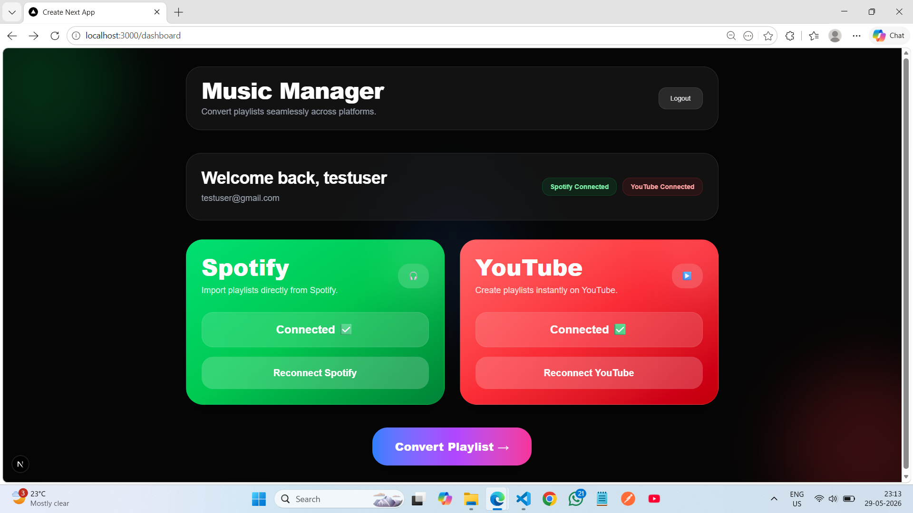
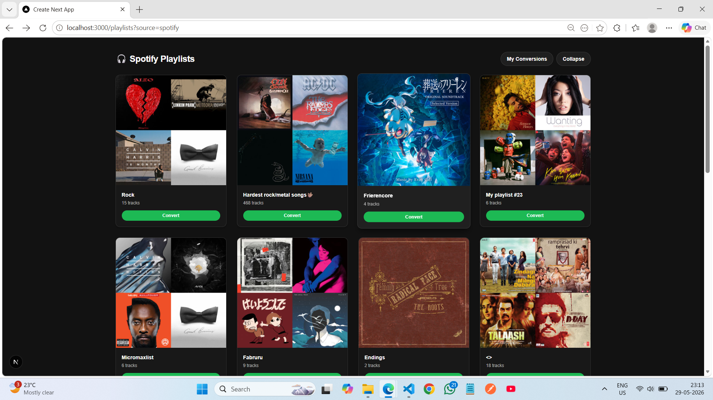
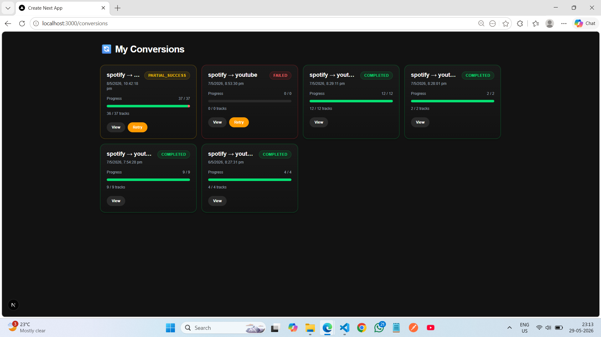
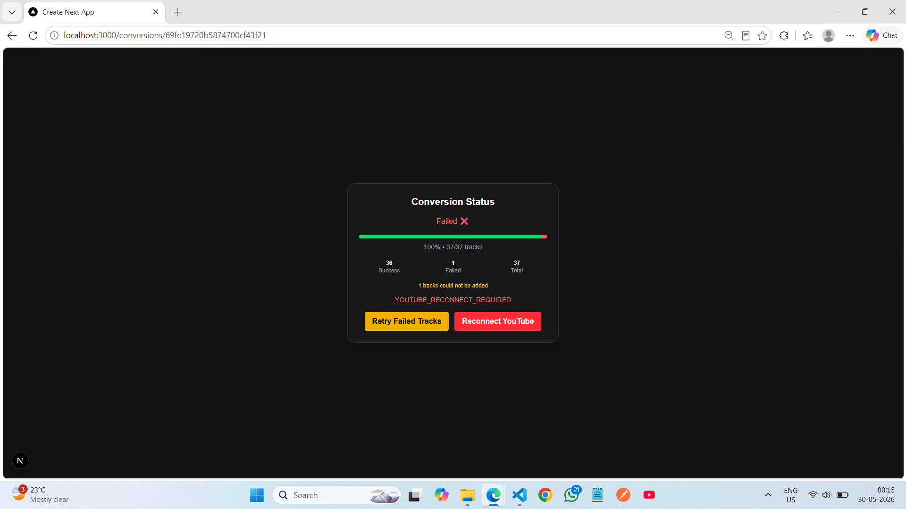

# 🎵 Music Manager SaaS

A full-stack SaaS application for seamless playlist transfer across music platforms such as **Spotify** and **YouTube Music**.

Built with Next.js, Express.js, MongoDB, Redis, and BullMQ, the application uses OAuth integrations and asynchronous background processing to handle cross-platform playlist conversion, long-running tasks, API failures, and recovery workflows.

The project includes a **Docker Compose development environment** with separate frontend, API, database, Redis, and background worker services.

---

## 🚀 Live Demo

🌐 **Live Application:** [Music Manager SaaS](https://music-manager-saas.vercel.app/)

> The live deployment and local Docker environment may use different configurations and environment variables.

---

## ✨ Features

### 🔐 Authentication & Platform Integration

- JWT-based authentication
- Spotify OAuth 2.0 integration
- YouTube OAuth 2.0 integration
- OAuth reconnect flows
- Protected routes and session handling

### 🎼 Playlist Management

- Fetch user playlists
- Playlist metadata normalization
- Spotify → YouTube Music playlist conversion
- Cross-platform track matching
- Playlist creation on the destination platform

### ⚡ Asynchronous Processing & Reliability

- Background job processing with **BullMQ and Redis**
- Conversion progress tracking
- Retry failed tracks without rerunning the entire conversion
- Partial success handling
- Exponential backoff retry logic
- Recovery from transient API failures

### 🎨 User Experience

- Responsive Next.js interface
- Connected platform management
- Playlist browsing
- Conversion status monitoring
- Progress tracking and failure recovery workflows

### 🐳 Dockerized Development Environment

- Containerized frontend and backend
- MongoDB database container
- Redis queue and job coordination
- Dedicated background worker container
- Service-to-service communication through Docker Compose
- Health checks and dependency coordination for supporting services

---

## 🛠 Tech Stack

### Frontend

- **Next.js**
- React
- Tailwind CSS
- Axios

### Backend

- **Node.js**
- Express.js
- MongoDB
- Mongoose
- JWT authentication

### Background Processing

- **Redis**
- **BullMQ**
- Dedicated conversion worker
- Retry and backoff handling

### APIs & Integrations

- Spotify Web API
- YouTube Data API
- Spotify OAuth 2.0
- Google OAuth 2.0

### Infrastructure & Deployment

- **Docker**
- **Docker Compose**
- MongoDB
- Redis
- Vercel — frontend deployment
- Render — backend deployment

---

## 🏗 System Architecture

### High-Level Architecture

```text
                   User
                    |
                    v
             Next.js Frontend
               Port 3000
                    |
                    v
              Express API
               Port 5000
              /         \
             v           v
        MongoDB        BullMQ
                          |
                          v
                        Redis
                          |
                          v
                  Conversion Worker
                          |
                          v
                Spotify Playlist Fetch
                          |
                          v
                  Track Normalization
                          |
                          v
                 YouTube Track Matching
                          |
                          v
                  Playlist Creation
                          |
                          v
                  MongoDB Updates
                          |
                          v
                Frontend Progress UI
```

### Docker Compose Services

The local environment consists of five services:

| Service | Responsibility | Local access |
|---|---|---|
| `frontend` | Next.js user interface | `localhost:3000` |
| `api` | Express REST API | `localhost:5000` |
| `mongo` | Persistent application data | `localhost:27017` |
| `redis` | BullMQ queue and job coordination | `localhost:6379` |
| `worker` | Asynchronous conversion jobs | Internal service |

The frontend communicates with the API, while the API and worker communicate with MongoDB and Redis. The worker runs independently of the API process, allowing background jobs to be processed separately from incoming HTTP requests.

---

## 🐳 Run Locally with Docker

Docker Compose is the recommended way to start the complete local environment.

### Prerequisites

Install:

- [Docker Desktop](https://www.docker.com/products/docker-desktop/)
- Git
- A Spotify developer application
- Google OAuth credentials and YouTube Data API credentials

Make sure Docker Desktop is running before executing the commands below.

### 1. Clone the Repository

```bash
git clone https://github.com/mpgit03/music-manager-saas.git
cd music-manager-saas
```

### 2. Configure Environment Variables

Configure the environment files expected by the backend and frontend.

#### Backend environment

Use `backend/.env.example` as a template for `backend/.env`, if provided in the repository.

Configure the required variables:

```env
PORT=5000
NODE_ENV=development

MONGO_URI=your_mongodb_uri

JWT_SECRET_KEY=your_secret
JWT_EXPIRES_IN=7d

SPOTIFY_CLIENT_ID=your_spotify_client_id
SPOTIFY_CLIENT_SECRET=your_spotify_client_secret
SPOTIFY_REDIRECT_URI=your_spotify_redirect_uri

GOOGLE_CLIENT_ID=your_google_client_id
GOOGLE_CLIENT_SECRET=your_google_client_secret
GOOGLE_REDIRECT_URI=your_google_redirect_uri

YOUTUBE_API_KEY=your_youtube_api_key

REDIS_URL=your_redis_url

FRONTEND_URL=http://localhost:3000
```

**Docker configuration note:** Inside Docker Compose, the API and worker should use the internal Redis service address, `redis://redis:6379`, rather than `localhost:6379` or a Redis Cloud URL when using the local Redis container. The MongoDB URI must likewise point to the Compose database service when using the local MongoDB container.

Use the actual environment variable names and defaults expected by your configuration files.

#### Frontend environment

Configure the frontend API URL according to the frontend environment setup:

```env
NEXT_PUBLIC_API_URL=http://localhost:5000/api
```

For Docker, ensure the frontend's API URL matches how the browser accesses the API. Browser-facing requests generally need a host-accessible URL, while container-to-container requests can use the internal service name.

### 3. Start All Services

From the project root, run:

```bash
docker compose up -d --build
```

This builds the application images and starts the services in the background.

### 4. Verify the Services

```bash
docker compose ps
```

Check that all five services are running. MongoDB, Redis, and the API should report healthy status where health checks are configured.

### 5. Access the Application

| Component | URL |
|---|---|
| Frontend | http://localhost:3000 |
| Backend API | http://localhost:5000 |
| Backend health check | http://localhost:5000/health |

### 6. View Logs

View all service logs:

```bash
docker compose logs -f
```

View API and worker logs:

```bash
docker compose logs -f api worker
```

View frontend logs:

```bash
docker compose logs -f frontend
```

Press `Ctrl+C` to stop following the logs. This does not stop the containers.

### 7. Stop the Application

```bash
docker compose down
```

This stops and removes the Compose containers and network. Named database volumes are retained unless explicitly removed.

> **Warning:** Avoid `docker compose down -v` when you want to preserve local database data, because it removes associated named volumes.

---

## 💻 Manual Development Setup

You can also run the frontend and backend outside Docker if you prefer working directly with Node.js.

### 1. Install Backend Dependencies

```bash
cd backend
npm install
```

Configure the backend environment variables before starting the server.

### 2. Start the Backend

```bash
npm run dev
```

### 3. Start the Background Worker

In a separate terminal, run the worker using the script defined in `backend/package.json`.

For example, if the configured script is `workers:rss`:

```bash
npm run workers:rss
```

Run the conversion worker using its actual configured script if it has a separate entry point.

### 4. Start the Frontend

In another terminal:

```bash
cd music-manager-frontend
npm install
npm run dev
```

Ensure MongoDB and Redis are running and that the connection strings point to the appropriate instances.

---

## ⚙️ Engineering Highlights

### OAuth-Based Multi-Platform Integration

Implemented OAuth 2.0 authentication flows for Spotify and Google/YouTube, including:

- Authorization and callback handling
- Token exchange
- Token refresh and reconnect workflows
- Account linking
- Handling expired or invalid authorization

These integrations allow users to authorize access to their music accounts without sharing their passwords with the application.

### Asynchronous Job Processing

Playlist conversion can involve many external API requests and may take longer than a typical HTTP request.

Instead of performing the entire conversion synchronously, the application uses **BullMQ queues backed by Redis**.

This enables:

- Non-blocking API requests
- Independent background processing
- Job retries
- Conversion progress tracking
- Better isolation between HTTP traffic and long-running work

### Retry & Recovery Pipeline

External APIs can fail because of quota exhaustion, expired tokens, transient errors, or destination playlist insertion failures.

The recovery workflow supports:

- Exponential backoff for retryable failures
- Partial conversion success
- Selective retry of failed tracks
- Graceful handling of API failures

Retrying only failed tracks avoids repeating successful work unnecessarily.

### Track Normalization & Matching

The conversion pipeline normalizes track metadata to improve matching across music platforms.

Matching signals include:

- ISRC metadata where available
- Track title
- Artist names
- Album metadata

Parallel processing can improve throughput when used with appropriate concurrency limits and API quota controls.

### Modular Backend Architecture

The backend separates responsibilities into components such as:

- Controllers
- Routes
- Middleware
- Models
- Services
- Queues
- Workers
- Utilities

This separation improves maintainability and makes it easier to test and evolve individual parts of the application.

---

## 🔥 Key Engineering Challenges

### YouTube API Quota Exhaustion

YouTube API quota limits can prevent track searches or playlist operations from completing.

The application incorporates failure handling and recovery workflows so that API failures do not necessarily invalidate an entire conversion.

### Transient `409 ABORTED` Playlist Insertion Errors

Playlist insertion can encounter transient API errors.

Retry logic with exponential backoff helps recover from retryable failures without immediately repeating requests at the same rate.

### OAuth Token Expiration

Expired or invalid credentials can interrupt playlist operations.

Reconnect flows allow users to restore authorization instead of treating every authentication failure as an unrecoverable application error.

### Queue-Worker Synchronization

BullMQ requires the producer and worker to use compatible queue names and Redis configuration.

Separating the worker into its own Docker Compose service makes its lifecycle and logs independently observable.

### Cross-Platform Track Matching

Music metadata is not always identical across platforms. Normalization and multiple matching signals improve matching reliability, although exact matches cannot be guaranteed for every track.

---

## 📂 Project Structure

```text
music-manager-saas/
├── backend/
│   ├── controllers/
│   ├── middleware/
│   ├── models/
│   ├── queues/
│   ├── routes/
│   ├── services/
│   ├── workers/
│   ├── utils/
│   ├── server.js
│   ├── package.json
│   └── .env.example
│
├── music-manager-frontend/
│   ├── app/
│   ├── components/
│   ├── lib/
│   ├── package.json
│   └── next.config.mjs
│
├── assets/
├── .gitignore
├── Dockerfile
├── docker-compose.yaml
└── README.md
```

> The tree is illustrative. Actual Dockerfile locations, Compose filename, and individual directories should match the files committed in the repository.

---

## 📸 Screenshots

### Dashboard

Responsive dashboard displaying connected platforms and playlist conversion access.



### Playlist Library

Browse playlists fetched from Spotify.



### Conversion Progress Tracking

Conversion progress powered by asynchronous background processing.



### Retry Failed Tracks

Retry failed tracks without rerunning the entire playlist conversion.



---

## 🔐 Security & Configuration

- Keep real `.env` files out of version control.
- Commit example environment files containing placeholders only.
- Never expose Spotify client secrets, Google client secrets, JWT secrets, or database credentials.
- Configure OAuth callback URLs in the corresponding provider dashboards.
- Use environment-specific API URLs and callback URLs for local development and deployed environments.
- Avoid exposing database and Redis ports publicly in production.
- Use HTTPS and appropriate access controls for deployed services.

---

## 🗺️ Future Improvements

- WebSocket-based real-time conversion updates
- Apple Music integration
- Playlist synchronization across platforms
- AI-powered playlist recommendations
- CI/CD pipelines
- Collaborative playlists
- User analytics dashboard
- Improved automated testing and observability
- Production deployment of the complete containerized stack

---

## 👨‍💻 Author

**Marut Panwar**

- GitHub: [mpgit03](https://github.com/mpgit03)
- LinkedIn: [Marut Panwar](https://www.linkedin.com/in/MarutPanwar)

---

*Built to explore full-stack SaaS development, OAuth integrations, asynchronous job processing, queue-based architectures, and containerized application development.*